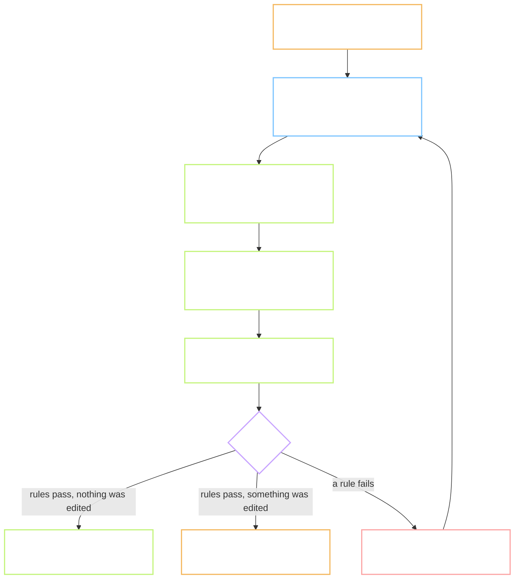
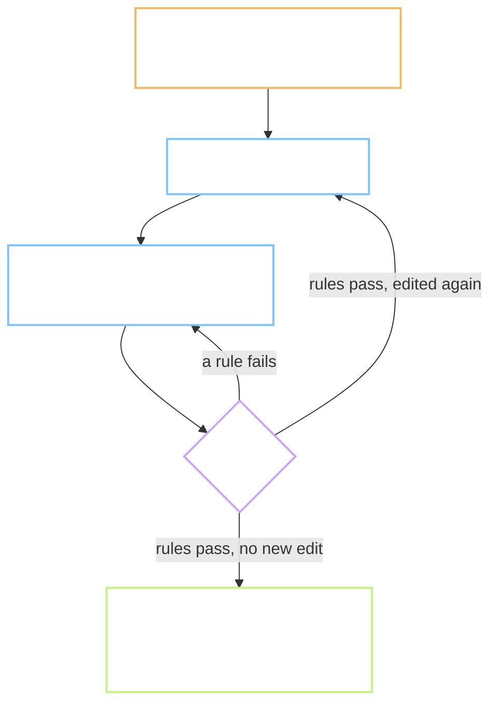

# Flow - P.5 the content workbench

Task: `P.5` · Plan: `Plan.md` in this folder
For: the person who reviews content, and the person who tests the tool.
"You" below is the reviewer. Nothing here is seen by a learner.

> Short sentences. Screen names and key names are written as you see them, in bold.

---

## 1. What changes for the reviewer

Before: no tool. Candidates would sit in a spreadsheet, with audio and pictures in other windows.

After: one page shows one word with everything needed to judge it. Your hands stay on the keyboard.

## 2. The main path

Everything you choose, tick or type is saved at once. **A** only decides the statuses.

**What A does to the records you did not choose: they become Loại.** Leaving a good third
sentence unchosen rejects it. You can open the word again and choose it; the word then needs
**A** again.

## 3. The word screen

| Area | What you see | What you can do |
| --- | --- | --- |
| Top bar | position "7 / 30", the word's status, a running timer, the queue: **Duyệt lần 1** or **Duyệt lần 2** | **J** next word, **K** previous word, **Q** switches the queue |
| Word | the word, its part of speech, IPA, the sound list as text, **Bảng khẩu hình** | **Bảng khẩu hình** opens the sheet of mouth shapes beside the word |
| Audio | **Nữ** and **Nam**, or **Chưa có audio** | **R** plays both, one after the other |
| **Nghĩa** | each meaning in simple English, its **Nghĩa Việt**, a source link, a licence badge | Space chooses or drops it; **E** opens **Nghĩa Việt** |
| **Câu ví dụ** | each sentence in English and Vietnamese, five tick boxes, a word count, a source link, a licence badge | Space chooses or drops it; **T** ticks all five; Shift+**1** to Shift+**5** ticks one; **E** opens the text |
| **Ảnh** | up to four pictures, numbered, or **Chưa có ảnh** | **1** to **4** picks one; **0** means none fits and asks why |
| Bottom bar | the keys, and the last message | **A** approve, **X** reject the word, **U** undo a reject, **O** open the source |

The five tick boxes are: **Đúng ngữ pháp**, **Tự nhiên**, **Không nhạy cảm**, **Nghĩa Việt khớp**,
**Đúng dạng từ**.

Tab and Shift+Tab move from record to record. A text field opens only with **E**. Enter saves
and closes it. Esc closes it without saving. While it is open, letters are letters.

## 4. Before and after, by situation

"Before" is the same in every row: there was no tool.

| Situation | After |
| --- | --- |
| You press **A**, the rules pass, you edited nothing | the word is **Đã duyệt**; the next word opens; the timer starts again |
| You press **A**, the rules pass, you edited a record | the word is **Cần duyệt lần 2** and appears in **Duyệt lần 2** |
| You press **A** with one sentence chosen | no status changes; the message reads **Cần 2 đến 3 câu**; your choice stays |
| A Vietnamese meaning has nine words | the field is marked; **A** is refused with **Nghĩa Việt tối đa 8 từ** |
| A chosen sentence has 14 words | you can choose it; its word count is marked; **A** is refused with **Câu phải dài 6 đến 12 từ** |
| A chosen record's licence is not allowed | its badge is red; **A** is refused with **Giấy phép không hợp lệ** |
| You press **E** and change a sentence | it is saved at once and shows **Cần duyệt lần 2**; its five ticks are cleared; the word's status waits for **A** |
| You change a text, then press **J** | nothing is lost; the word is still **Chờ duyệt** |
| There are four pictures and you press **A** without **1** to **4** or **0** | refused with **Chọn ảnh 1 đến 4 hoặc bấm 0** |
| You press **0** | a small field asks for a reason; all four pictures become **Loại** |
| You press **X** | a small field asks for a reason; only the word becomes **Loại**; your choices on its records stay |
| You pressed **X** by mistake | **U** sets the word back to **Chờ duyệt** |
| A word has no meaning candidates | the area says **Chưa có nghĩa ứng viên**; **A** is refused; press **J**. Do not reject it |
| A word has no pictures | the area says **Chưa có ảnh**; the word can still be approved |
| A word has no audio | the area says **Chưa có audio**; the word can still be reviewed |
| You open a word that is **Đã duyệt** and change a choice | the word returns to **Chờ duyệt** until you press **A** again |
| You press **O** on a record | its source opens in a new tab; the record keeps who checked it and when |
| You leave the tab | the timer pauses and resumes when you return |
| You hold a key down | it counts once |
| Another tab saved first | your save is refused; the message asks you to reload |

## 5. The second pass

**Duyệt lần 2** lists only words with an edited record. The same rules apply there. A word
leaves the queue when someone approves it without editing again.

## 6. What the reviewer never has to do

- Open a spreadsheet to find the source of a sentence. The link is beside it.
- Write down the time. The tool keeps seconds per word.
- Remember which words were changed. The second queue remembers.
- Fear a wrong key. A choice is saved at once, and a reject can be undone.

## 7. What is deliberately not here

- No sign-in. The tool runs on one machine and takes the reviewer's short name when it starts.
- No picture of the mouth for each sound. The sound list is text, with one sheet of all mouth
  shapes to open. Task 3.3 draws the pictures.
- No check that a sentence uses only easy words. That needs the full word list of task P.9.
  The screen checks the length only.
- No seconds per sentence. The timer runs per word.
- No way to add a new candidate from nothing. You can edit a candidate; new ones come from the pipeline.
