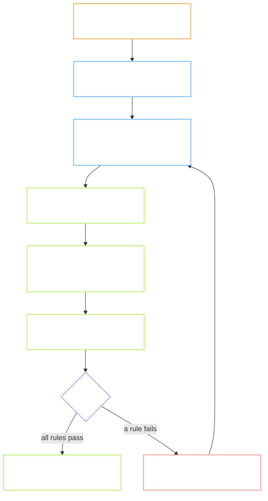
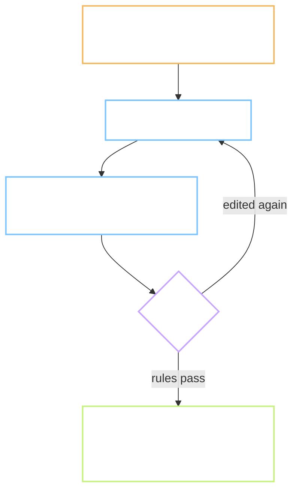

# Flow - P.5 the content workbench

Task: `P.5` · Plan: `Plan.md` in this folder
For: the person who reviews content, and the person who tests the tool.
"You" below is the reviewer. Nothing here is seen by a learner.

> Short sentences. Screen names and key names are written as you see them, in bold.

---

## 1. What changes for the reviewer

Before: no tool. Candidates would sit in a spreadsheet, with audio and pictures in other windows.

After: one page shows one word with everything needed to judge it. Your hands stay on the keyboard.

## 2. The main path

One word, one decision. A refusal always says which rule failed.

## 3. The word screen

| Area | What you see | What you can do |
| --- | --- | --- |
| Top bar | position "7 / 30", the word's status, a running timer, the name of the queue | **J** next word, **K** previous word |
| Word | the word, its part of speech, IPA, the sound list | nothing; this part is not reviewed here |
| Audio | **Nữ** and **Nam** | **R** plays both again, one after the other |
| **Nghĩa** | each candidate meaning in simple English, a field **Nghĩa Việt**, a source link, a licence badge | Space chooses or drops a meaning; **E** opens the field |
| **Câu ví dụ** | each sentence in English and Vietnamese, five tick boxes, a word count, a source link, a licence badge | Space chooses or drops; **T** ticks all five; **E** edits the text |
| **Ảnh** | up to four pictures, numbered | **1** to **4** picks one; **0** means none fits |
| Bottom bar | the keys, and the last message | **A** approve, **X** reject |

The five tick boxes are: **Đúng ngữ pháp**, **Tự nhiên**, **Không nhạy cảm**, **Nghĩa Việt khớp**,
**Đúng dạng từ**.

## 4. Before and after, by situation

| Situation | Before | After |
| --- | --- | --- |
| You press **A** and everything is in order | no tool | the word is saved as **Đã duyệt**; the next word opens; the timer restarts |
| You press **A** with one sentence chosen | no tool | nothing is saved; the message reads **Cần ít nhất 2 câu** |
| A Vietnamese meaning has nine words | no tool | the field is marked; **A** is refused with **Nghĩa Việt tối đa 8 từ** |
| A sentence has 14 words | no tool | its word count is marked; it cannot be chosen until it is edited |
| A record's licence is not allowed | no tool | its badge is red; **A** is refused while that record is chosen |
| You press **E** and change a text | no tool | the record shows **Cần duyệt lần 2**; after **A** the word goes to the second queue, not to **Đã duyệt** |
| You press **X** | no tool | a small field asks for a reason; the word is saved as **Loại** |
| A word has no meaning candidates | no tool | the screen says **Chưa có nghĩa ứng viên**; only **X** or **J** make sense |
| A word has no pictures | no tool | the area says **Chưa có ảnh**; the word can still be approved |
| You leave the tab | no tool | the timer pauses and resumes when you return |
| You hold a key down | no tool | it counts once |
| You type in a text field | no tool | letter keys write letters; they do not approve or reject. **Esc** leaves the field |

## 5. The second pass

The top bar has two queues: **Duyệt lần 1** and **Duyệt lần 2**. The second lists only words
that were edited. A word leaves it when someone approves it without editing again.

## 6. What the reviewer never has to do

- Open a spreadsheet to find the source of a sentence. The link is beside it.
- Write down the time. The tool keeps seconds per word.
- Remember which words were changed. The second queue remembers.

## 7. What is deliberately not here

- No sign-in. The tool runs on one machine and takes the reviewer's short name when it starts.
- No picture of the mouth for each sound. The sound list is shown as text until task 3.3.
- No way to add a new candidate from nothing. You can edit a candidate; new ones come from the pipeline.
