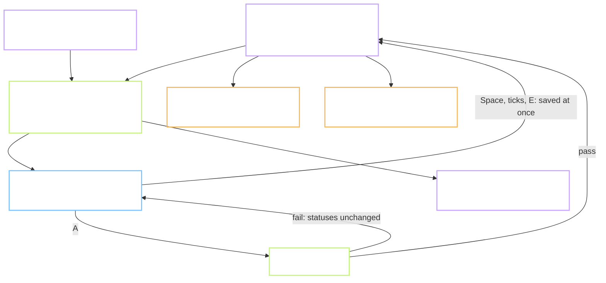

# Plan - P.5 the content workbench: review one word per screen, by keyboard

Status: **in progress**. Gate A approved 2026-10-13. Gate B not reached.
Task: `P.5` · Prompt: `prompts/phase-P/P.5.md` · Record: `records/P.5.md`
Branch: `chore/p5-content-workbench`, cut from `main` at `b84c4fe`.
Run with: `/task-lead P.5`. Lead: this session. Helpers: `evidence-scout`, `gate-reviewer`. No builder agent, decision 2.
Reviewer: `self`, plus the `gate-reviewer` agent before Gate A and before Gate B
Type: **FEATURE** - a tool with a screen and review logic. Its user is the content reviewer, not a learner.
Level: **L2** - decided by the owner, decision 2. See the level note.
Repro: not applicable, this is not an ISSUE
User-visible behaviour: see `Flow.md` in this folder. "User" there means the reviewer.
Refs: `docs/09` section 4.3 and row P.5 · `docs/01` sections 6.2, 6.3, 6.4, 13.1 · `docs/07` sections 5.5 and 7.1 ·
TC-CT-07 as a rule the tool enforces · the length half of TC-CT-06 · `verify_pack.py --strict`
Depends on: P.1 (done). Uses the voices from P.4 (done). Does **not** wait for P.7 and P.8, see 4.7.

**Level note.** This task writes down working files that task P.8 will fill and task 1.7 will
read. Part of the shape comes from the design: the SENSE and EXAMPLE columns of `docs/07`
section 7.1 and the five fields of `docs/09` line 182. Part is new here: `chosen`, `checks`,
`note`, the image file, the word status file and the log. The new part is review bookkeeping;
no shipped table changes. The owner chose L2 for it. The shape goes into `docs/07` section 5.5.

**Decisions log (2026-10-09):**
1. 2026-10-09 - Plan written by the lead from the scout's table. No review round yet.
2. 2026-10-13 - **The owner answered the six questions.** (1) Stack: Python standard library
   server and one plain page. (2) Level: L2; the working-file shape is written here and added
   to `docs/07` section 5.5. (3) Seed data: the session may write draft Vietnamese meanings and
   draft sentences for the 30 test words, all `pending`, in `content/pack/trial/`. (4) Reviewer
   name: the owner's own; `hieudelfi` is used, the name already in this repo's history. It is a
   start-up argument and can change. The same name may close a second pass; the log shows it.
   The owner did not answer that half, so the lead's recommendation stands until told otherwise.
   (5) Evidence: two screenshots by the owner, not a video. (6) Tokens: the middle level. The
   lead writes the code itself, with no builder agent. `gate-reviewer` reads this plan before
   Gate A and reads the diff before Gate B.
3. 2026-10-13 - **Second reader on the plan and the flow: 41 defects. Both files rewritten.**
   What changed, in the order it matters:
   - *When work is saved.* Every choice, tick and edit is saved at once. **A** only changes
     statuses. A refused **A** loses nothing.
   - *One state table* (4.3), with the edited-word branch, the second pass acting on records,
     and the approve rules running again there.
   - ***X** rejects the word only.* The records are left alone, a reason is stored, and **U**
     undoes it. A word with no meaning candidates is skipped, never rejected.
   - *Keys.* Space chooses a record. Shift with **1** to **5** ticks one check. **0** rejects all
     four images with a reason. Esc leaves a text field. Text fields are not Tab stops.
   - *An edit clears the five ticks* of that sentence.
   - *The export stays inside the working folder* and refuses drafts outside a trial.
   - *Missing columns added*: `collocations_json`, `audio_asset_f`, `audio_asset_m`,
     `second_by`, `second_at`, `source_checked_by`, `source_checked_at`, a second source pair
     for the Vietnamese meaning, `note` on images, a reason on the word.
   - *A checker for the working files*, since `verify_pack.py` reads word rows only.
   - *Line endings fixed to LF* in the files the tool writes, with a `.gitattributes` rule.
   - *Trial audio needs its own small script*; the P.3 and P.4 scripts do not cover 30 words.
   - *Tests now have thresholds*; the rule tests are listed by name.
   - *Three things are stated as not done*: the frequency half of TC-CT-06, seconds per
     sentence, and a mouth picture per sound.
4. 2026-10-13 - **Gate A approved by the owner**, on the rewritten plan and flow.
5. 2026-10-13 - **One key added while building: Q switches between the two queues.** The plan
   gave the queues as two buttons only. Test 3 asks for a full review with the mouse untouched,
   and that includes one word through the second pass. Tab moves between records, so the
   buttons could not be reached by keyboard. `Flow.md` section 3 has the key as well.

Out of scope: downloading any source (P.7), joining sources (P.8), generating real images, a
mouth picture for each sound (task 3.3), the frequency-rank half of TC-CT-06 (needs the word list
of P.9), seconds per sentence, the second reviewer's 20 percent sample, the phonetics sign-off,
packing (1.7), Playwright and axe tests.

> **Language rule (B1/B2):** short sentences, 20 words or fewer. Active voice. One idea per sentence.

Short names. **Workbench** is the tool built here. **Record** is one meaning, one sentence or
one image candidate. **Candidate** is a record nobody has judged yet. **Chosen** means the
reviewer wants this record in the product. **Second pass** is the queue of words with an edited
record. **Draft** is seed text written by this session for the trial.

---

## 0. Does this task need a Flow.md?

Yes. It has a screen and the review rules are behaviour. `Flow.md` is in this folder.

## 1. Goal

After this task one person can judge a word from one screen, by keyboard. The screen shows its
candidate meanings, sentences, pictures and audio side by side. Every decision lands in a file
with who and when. The tool also records seconds per word. The project planned about 670 hours
of review on a guess.

## 2. Starting point, checked today

Facts from the `evidence-scout` helper on 2026-10-09, line numbers confirmed with `grep -n`.
The second reader spot-checked five of them on 2026-10-13; all held.

| Thing | State today | Evidence |
| --- | --- | --- |
| `tools/workbench/` | does not exist | `ls tools` prints `checks ops pipeline` |
| The three working files | exist nowhere; named only in the prompt | grep: one hit, `prompts/phase-P/P.5.md:9` |
| Status values | `pending`, `approved`, `rejected`, `needs_second`, defined only in the prompt | `prompts/phase-P/P.5.md:12` |
| Fields every record must carry | `source`, `license`, `review_status`, `reviewed_by`, `reviewed_at` | `docs/09-ke-hoach.md:182` |
| Other fields the data test plan asks for | `source_checked_by` and a date; two reviewer names | `docs/09-ke-hoach.md:173`, `:174` |
| Meaning table in the design | `sense_id`, `item_id`, `order`, `gloss_vi`, `def_en_simple`, `collocations_json` | `docs/07-kien-truc.md:431-438` |
| Sentence table in the design | `example_id`, `sense_id`, `en`, `vi`, `difficulty`, `audio_asset_f`, `audio_asset_m` | `docs/07-kien-truc.md:439-447` |
| Image in the design | no table; one column `image_asset` on the word | `docs/07-kien-truc.md:428` |
| Review columns in the design | none | grep for `review_status` in `docs/07`: no hit |
| Hand-review step in the pipeline | drawn as "Google Sheet / CSV", no file named | `docs/07-kien-truc.md:307` |
| Rules for meanings | 1 to 3 per word; Vietnamese meaning 8 words or fewer | `docs/01-yeu-cau.md:291`, `:271` |
| Rules for sentences | 2 to 3 per word, 6 to 12 words; five checks | `docs/01-yeu-cau.md:293`, `:143` |
| Image rule | pick 1 of 4 or reject all 4; record the pick and the reason | `docs/09-ke-hoach.md:177` |
| Source rule | every record shows a source link; licence on the allowlist | `docs/09-ke-hoach.md:173`; TC-CT-07 at `docs/08-kiem-thu.md:262` |
| `verify_pack.py` | reads word rows only; needs `ipa_us` and `arpabet` on every row | `tools/checks/verify_pack.py:23-41` |
| `verify_pack.py --strict` | needs `gloss_vi`, `n_examples` of 2 or more, `review_status` equal to `approved`; an empty file passes | `tools/checks/verify_pack.py:37-40`, `:47-50` |
| Target speed | 3 minutes per word, 40 seconds per sentence | `docs/09-ke-hoach.md:182` |
| A screen design for the workbench | none | grep in `docs/06-thiet-ke-ui-ux.md`: no hit |
| Candidate meanings on disk | WordNet definitions for 28 of 30 test words; `hello` and `through` have none | column `wn_defs` in `lexicon_raw_test.csv` |
| Candidate sentences, images | none | `ls content/pack`: no CSV |
| Scripts that speak words | 5 words in the old voice pair; 20 words in 5 voices with blind names | `tools/pipeline/env/_paths.py:20-32` |
| The chosen male voice in code | not there; `VOICES` still holds `am_michael` | `tools/pipeline/env/_paths.py:22` |
| A single-word verb reading of "wind" | does not exist | `_paths.py:39-42` checks a sentence only |
| Line-ending rule in the repo | none | no `.gitattributes`, no `.editorconfig` |
| Allowlist values the seed needs | `WordNet`, `own`, `self` are present | `tools/checks/license-allowlist.txt:15-17` |
| Licence gate | scans `web/` only | `tools/checks/check_licenses.mjs:12`; `tools/checks/gate.sh:25,34` |

**Still assumptions:**

- A page served from `127.0.0.1` by Python's built-in server is enough for one reviewer. Not tried.
- A browser plays an Opus file served by that server. P.4's page played Opus from disk.
- One person reviews at a time.

## 3. Flow



Work is saved as it is done. **A** only decides statuses. Every rule lives in the server.

## 4. Plan of work

### 4.1 Stack - decided

`tools/workbench/server.py` uses only `http.server`, `csv` and `json`. `tools/workbench/static/`
holds one HTML page with plain JavaScript and CSS. No build step, no `package.json`, no new
package. The server takes the working folder and the reviewer name as arguments.

### 4.2 The working files - required

One working folder holds them all. UTF-8, one header row, LF line ends, quotes only where
needed. `.gitattributes` gets `content/pack/**/*.csv text eol=lf`. The tool keeps any column it
does not know, in place.

| File | Columns |
| --- | --- |
| `senses.csv` | `sense_id`, `item_id`, `order`, `def_en_simple`, `gloss_vi`, `collocations_json`, `chosen`, `source`, `license`, `gloss_source`, `gloss_license`, the review fields, `note` |
| `examples.csv` | `example_id`, `sense_id`, `item_id`, `en`, `vi`, `difficulty`, `audio_asset_f`, `audio_asset_m`, `checks`, `chosen`, `source`, `license`, the review fields, `note` |
| `images.csv` | `image_id`, `item_id`, `slot`, `path`, `chosen`, `reject_reason`, `source`, `license`, the review fields, `note` |
| `word_review.csv` | `item_id`, `review_status`, `reviewed_by`, `reviewed_at`, `second_by`, `second_at`, `reject_reason` |
| `review_log.csv` | `at`, `reviewer`, `pass`, `item_id`, `action`, `target`, `seconds` - append only |

The **review fields** are `review_status`, `reviewed_by`, `reviewed_at`, `second_by`,
`second_at`, `source_checked_by`, `source_checked_at`.

- `source` and `license` on a meaning describe the English definition. `gloss_source` and
  `gloss_license` describe the Vietnamese meaning. One row can then be truthful about both.
- `checks` is five characters, `0` or `1`, in the order of the five checks.
- `collocations_json`, `audio_asset_f` and `audio_asset_m` are carried, not edited. Tasks 1.2
  and 1.4 fill them.
- `note=draft` marks seed text. The tool never clears it.
- IDs follow the word: `w:market#1/s1`, `w:market#1/s1/e2`, `w:market#1/i3`.

Every save writes a temporary file and renames it. Each file has a version, its size and
modified time. A save from a page that read an older version is refused.

### 4.3 The states, in `tools/workbench/review.py` - required

No HTTP in this file, so `pytest` runs it.

**Saved at once, status unchanged:** choosing or dropping a record, ticking a check, picking an image.

**An edit** (key **E**, then typing): saved at once. The record becomes `needs_second`. If it is
a sentence, its five ticks are cleared. The word's status does not change yet.

**Approve, key A.** The rules, checked on the chosen records:

| # | Rule |
| --- | --- |
| R1 | 1 to 3 meanings are chosen |
| R2 | each chosen meaning has a Vietnamese meaning of 1 to 8 words |
| R3 | 2 to 3 sentences are chosen |
| R4 | each chosen sentence has 6 to 12 English words |
| R5 | each chosen sentence has all five checks ticked |
| R6 | each chosen record has a `source` and a `license` on the allowlist; a chosen meaning also has `gloss_source` and an allowed `gloss_license` |
| R7 | if the word has image candidates, one is picked, or all are rejected with **0** |

If a rule fails, no status changes and the screen names the rule. The saved choices stay.

What **A** writes when the rules pass:

| Record | Becomes |
| --- | --- |
| chosen, not edited | `approved` |
| chosen, edited (`needs_second`) | stays `needs_second` |
| not chosen | `rejected` |
| the word, when no chosen record is `needs_second` | `approved` |
| the word, when a chosen record is `needs_second` | `needs_second` |

**Second pass.** Lists words whose status is `needs_second`. **A** there runs R1 to R7 again.
On pass: each chosen `needs_second` record becomes `approved` with `second_by` and
`second_at`; the word becomes `approved` with the same two fields. A record edited again in the
second pass stays `needs_second`, and so does the word.

**Reject, key X.** Asks for a reason. Only the word becomes `rejected`, with the reason. Its
records keep their statuses and choices. **U** on a rejected word sets it back to `pending`.

**A word with no meaning candidates** cannot pass R1. It is skipped with **J** and stays
`pending`. The report lists it as "waiting for candidates". It is not rejected: its sentences
may be good.

**Reopening.** Any change on an `approved` or `rejected` word sets that word to `pending` and
the changed record to `pending`, or to `needs_second` if it was edited. The log keeps every event.

**Images.** **1** to **4** picks a slot. **0** rejects all four and asks for a reason, stored in
`reject_reason` on each. A word with no candidates passes R7.

**Source check, key O.** Opens the focused record's source link and stamps
`source_checked_by` and `source_checked_at` on it.

**Timer.** One log row per visit to a word: it starts when the word opens and ends when the
word is left by **A**, **X**, **J**, **K**, a queue switch or closing the page. It pauses while
the tab is hidden. The row carries the pass, the action and the seconds. The report adds up the
visits of a word. Seconds per sentence are not measured.

### 4.4 The page, in `tools/workbench/static/` - required

One word per screen: the word, its IPA, its sound list as text, a button that opens
`content/pack/viseme-sheet.svg` beside it, two audio buttons, the meanings, the sentences, up to
four images, and for every record a source link and a licence badge. A badge is red when the
licence is not on the allowlist. `Flow.md` holds the behaviour.

| Key | Does |
| --- | --- |
| **J**, **K** | next word, previous word |
| **Q** | switch between **Duyệt lần 1** and **Duyệt lần 2** (decision 5) |
| Tab, Shift+Tab | move focus from record to record. Text fields are not Tab stops |
| Space | choose or drop the focused meaning or sentence |
| **T** | tick all five checks of the focused sentence |
| Shift+**1** to Shift+**5** | tick or clear one check of the focused sentence |
| **E** | open the text of the focused record. Enter saves and closes. Esc closes without saving |
| **1** to **4**, **0** | pick an image; reject all four |
| **O** | open the source of the focused record and stamp the check |
| **R** | play both voices again |
| **A**, **X**, **U** | approve; reject the word; undo a reject |

While a text field is open, only Enter and Esc act as keys. A held key acts once.

Plain accessibility: every control has a label, focus is always visible, status is never shown
by colour alone. Automated axe tests need Playwright, which this repo does not have yet.

### 4.5 Export, checker and report - required

- `python tools/workbench/export.py <folder>` writes `<folder>/lexicon_reviewed.csv`. One row per
  approved word: the 14 lexicon columns, then `gloss_vi` (the approved Vietnamese meanings in
  order, joined with `; `), `n_senses`, `n_examples` (approved sentences), `image_asset` (the
  path of the picked image, or empty), `review_status`, `reviewed_by`, `reviewed_at`. It prints
  the approved words that have no image. It refuses any approved record with `note=draft`,
  unless `--trial` is given; with `--trial` the output file is named `lexicon_reviewed_trial.csv`.
- `python tools/workbench/check_files.py <folder>` is the data check for the working files:
  unique IDs, every `sense_id` and `item_id` exists, status values are valid, `checks` is five
  bits, every record has `source` and an allowed `license`, no word is `approved` with fewer
  than 1 approved meaning or 2 approved sentences. With `--for-pack` it also fails on any draft.
  It prints counts per status.
- `python tools/workbench/report.py <folder>` prints, from the log: words with a decision,
  seconds per word (mean, median, slowest), words over 15 minutes, words waiting for candidates.

### 4.6 `docs/07` section 5.5 - required

One paragraph and the table of 4.2, so P.8 and 1.7 read the shape from the architecture, not
from this plan. Section 7.1 is not changed.

### 4.7 Seed data for the trial - decided, decision 2

`tools/workbench/seed_trial.py` builds `content/pack/trial/`, all `pending`. The session
writes the draft text into a data file the script reads; the script only shapes it.

- **Meanings**: WordNet definitions from `lexicon_raw_test.csv`, `source=WordNet`,
  `license=WordNet`. A draft Vietnamese meaning each, `gloss_source=self`, `gloss_license=own`,
  `note=draft`. `hello` and `through` get none.
- **Sentences**: three drafts per word, `source=self`, `license=own`, `note=draft`. A few break
  a rule on purpose, to show the refusals: one of 14 words, one of 4 words.
- **Images**: four SVG pictures for five words, written as text by the script, `license=own`,
  `note=draft`. SVG needs no image library. The other 25 words have none.
- **Audio**: a new script, `tools/workbench/make_trial_audio.py`, run in the pipeline
  environment. It imports `_kokoro.py` and `encode_opus.py`, speaks 29 of the 30 items with
  `af_heart` and `am_adam`, and levels them. Files go to `content/pack/audio_test/workbench/`,
  ignored by git. `w:wind#2` gets no audio: its single-word reading does not exist yet. That
  also shows the "no audio" state.

`content/pack/trial/README.md` says in two lines that these are drafts and must not be packed.
The guard is in code as well: `export.py` and `check_files.py --for-pack` fail on drafts.

### Options considered, not chosen

- React with Vite, as `docs/09` line 167 names. The owner chose the plain stack.
- FastAPI. Not in `sdk-allowlist.md`; the standard library is enough for a few routes.
- SQLite as the working store. CSV diffs are readable in git, and P.8 writes CSV.
- A status on each field of a record, as `docs/09` line 167 hints. One status per record is
  what line 182 requires.
- **X** that rejects every record of the word. Rejected after review: one wrong key destroyed
  the reviewer's work.
- Saving only on **A**. Rejected after review: a refused **A** followed by **J** lost the work.

### Do not touch

- `content/lexicon/lexicon_raw_test.csv`. Read only; the gate checks it.
- `tools/checks/verify_pack.py`, `golden/`, `web/`, `supabase/`.
- `tools/pipeline/env/_paths.py` `WORDS` and `VOICES`, and the P.3 and P.4 scripts.
- `docs/07` section 7.1.

## 5. Situations and edge cases

| # | Situation | Expected behaviour |
| --- | --- | --- |
| 1 | **A** with one sentence chosen | refused, R3; statuses unchanged; the choice stays saved |
| 2 | A Vietnamese meaning of nine words | refused, R2; the field is marked |
| 3 | A chosen sentence of 14 words | it can be chosen; its count is marked; **A** is refused, R4 |
| 4 | A chosen record with a licence outside the allowlist | refused, R6; the badge is red |
| 5 | **E**, change a sentence, **J**, come back | the text and `needs_second` are saved; its ticks are empty; the word is still `pending` |
| 6 | Edit, tick again, **A** | the word goes to `needs_second`; unedited chosen records are `approved` |
| 7 | Second pass, **A** without editing | edited records and the word become `approved`, with `second_by` |
| 8 | Second pass, edit again, **A** | the word stays `needs_second` |
| 9 | **X** by mistake | only the word is rejected; **U** restores it; nothing else changed |
| 10 | A word with no meaning candidates | cannot be approved; skipped; reported as waiting |
| 11 | Four images, none picked, **A** | refused, R7 |
| 12 | **0** on the images | a reason is asked; all four are `rejected` with it |
| 13 | A word with no images | R7 passes; the export prints it under "no image" |
| 14 | An approved word is opened and a choice changes | the word returns to `pending`; the log keeps both events |
| 15 | The server stops in the middle of a save | the old file is intact |
| 16 | Two tabs save the same file | the second save is refused; the page asks to reload |
| 17 | A CSV has an unknown column | kept, in place |
| 18 | The reviewer walks away | the timer pauses when the tab is hidden; a word over 15 minutes is listed, not dropped |
| 19 | A request for a file outside the repo | refused |
| 20 | The page is opened from another machine | not reachable; `127.0.0.1` only |
| 21 | A key is held down | one action |
| 22 | A text field is open and **A** is typed | the letter is typed; nothing is approved |
| 23 | `w:wind#1` and `w:wind#2` | two screens; the ID is the key, not the spelling |
| 24 | A word with no audio | the audio area says so; the word can still be reviewed |
| 25 | Export of a folder that holds approved drafts, without `--trial` | refused, with the count of drafts |

## 6. Impact - who else touches this

| Thing created or changed | Consumer | Effect |
| --- | --- | --- |
| `tools/workbench/` | tasks 1.2, 1.3, 1.5, 1.12, 5.1 to 5.4 | new; the review tool for all content |
| The working-file shape | P.8 writes it, 1.7 reads it | new; in `docs/07` section 5.5 |
| `content/pack/trial/` | this task's trial only | new, tracked, drafts; guarded against packing |
| `tools/workbench/check_files.py` | P.8, 1.7, the gate later | new; the data check for working files |
| `tools/checks/test_workbench.py` | the gate | new tests |
| `.gitattributes` | everyone | new; LF for CSV under `content/pack/` |
| `tools/checks/gate.sh`, `verify_pack.py` | everyone | unchanged |
| `content/pack/audio_test/workbench/` | the trial | new, ignored by git |

Found with: the scout's table; the second reader's resource list; `ls content/pack`.

## 7. Tests and Definition of Done

Rule tests, each one a named test in `tools/checks/test_workbench.py`:

| # | Covers | Count |
| --- | --- | --- |
| T1 | R1 to R7, one failing case each, and one passing case | 8 |
| T2 | what **A** writes: all five rows of the table in 4.3 | 5 |
| T3 | edit sets `needs_second` and clears ticks; the word stays `pending` | 2 |
| T4 | second pass: approve; edit again | 2 |
| T5 | **X** touches the word only; **U** restores | 2 |
| T6 | reopening an approved word | 1 |
| T7 | images: pick, **0** with a reason, no candidates | 3 |
| T8 | save: a crash keeps the old file; a stale save is refused; unknown columns kept; LF and byte-equal untouched rows | 4 |
| T9 | server: a path outside the repo is refused; the bind address is `127.0.0.1` | 2 |
| T10 | export: join rule, counts, image path, refuses drafts, `--trial` name | 5 |
| T11 | checker: each of its failures, and `--for-pack` on a draft | 6 |
| T12 | report: visits added per word; a word over 15 minutes listed | 2 |
| T13 | page: `e.repeat` is checked; no letter key acts while a field is open | 2 |

Checks on the running tool:

| # | Test | How to run | Expected result |
| --- | --- | --- | --- |
| 1 | Rule tests | `pytest tools/checks/test_workbench.py -q` | 44 tests, all pass |
| 2 | Opens 30 words | start the server on `content/pack/trial` | `GET /api/words` returns 30 items |
| 3 | Reviewed by keyboard | the owner reviews at least 12 words, mouse untouched | at least 10 words `approved`, at least 1 through the second pass, at least 1 rejected and restored |
| 4 | Files before and after | `git diff --stat content/pack/trial/` after test 3 | changed lines are fewer than rows touched times 2; no line of an untouched record changes |
| 5 | Second pass | after one edit in test 3, open **Duyệt lần 2** | it lists exactly the edited words |
| 6 | Strict check | `export.py content/pack/trial --trial`, then `verify_pack.py --strict` on the output | 0 errors, and the file has 10 rows or more |
| 7 | Working files are sound | `check_files.py content/pack/trial` | exit 0; it prints at least 10 approved words; 0 approved records without source or allowed licence |
| 8 | Drafts cannot be packed | `check_files.py content/pack/trial --for-pack`; `export.py content/pack/trial` | both exit non-zero and name the drafts |
| 9 | Seconds per word | `report.py content/pack/trial` | decisions counted equal the words decided in test 3; mean, median, slowest printed. A measurement, with no pass line |
| 10 | Audio | `make_trial_audio.py`; the owner presses **R** on three words | 58 files, each `ok` on loudness and 300 to 4,000 ms; both voices heard |
| 11 | By hand | the owner: hide the tab for a minute; hold **J**; open two tabs | the timer does not count the minute; one step; the second save is refused |
| 12 | Gate | `bash tools/checks/gate.sh full` | exit 0 |

Output checks from `CLAUDE.md` section 3 that apply. Data: `verify_pack.py` on the export, and
`check_files.py` on the working files, since `verify_pack.py` reads word rows only. Audio:
length and loudness are checked by the audio script; every item has two voices except
`w:wind#2`, stated above; the owner hears three words, not 5 percent, because this audio is a
trial prop and is not packed. Code: tests green, no new dependency. Screen: two screenshots;
there is no mockup to compare with and no offline check, because the tool is not part of the app.

Honest limit of test 9: ten draft words with placeholder pictures do not test the 670-hour
estimate. They prove the timer works. Task 1.2 measures real review on the first 50 words.

**Definition of done:**

- [ ] 44 rule tests pass in the gate
- [ ] The workbench opens the 30 trial words; every key in 4.4 works without the mouse
- [ ] The owner reviewed 12 words or more: 10 or more approved, 1 through the second pass, 1 rejected and restored
- [ ] `verify_pack.py --strict` on the trial export: 0 errors on 10 rows or more
- [ ] `check_files.py` on the trial folder: exit 0; with `--for-pack`: refuses the drafts
- [ ] A seconds-per-word report from the owner's review, shown next to the 3-minute target
- [ ] The working-file shape is in `docs/07` section 5.5
- [ ] Two screenshots of the workbench, made by the owner
- [ ] `records/P.5.md` has a result line per step, the test table and the token line
- [ ] The branch is merged into `main` with `gate.sh merge`, and deleted

## 8. After Gate B

Planned commit messages:

```
feature(P.5): add review rules and safe CSV storage for the workbench
feature(P.5): add the workbench server and the one-word review page
feature(P.5): add export, the working-file checker and the seconds-per-word report
feature(P.5): add trial seed data and trial audio
docs(P.5): write the working-file shape into the architecture
```

Record note: `records/TRACKING.md` row P.5 gets status, effort, the measured seconds per word and the date.

## 9. Open questions for the reviewer

None. The six questions were answered on 2026-10-13, decision 2. One default stands until the
owner says otherwise: the same name may close a second pass.
