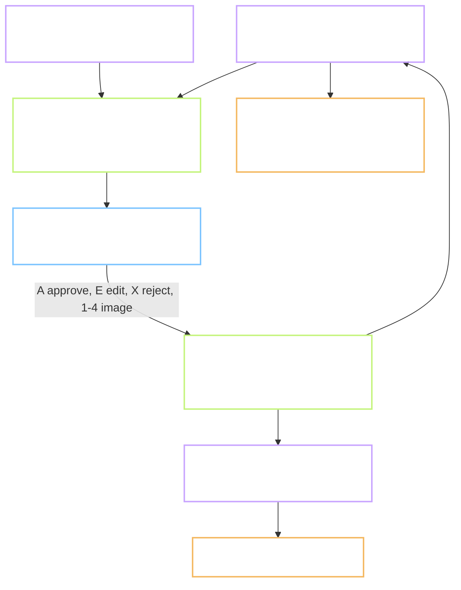

# Plan - P.5 the content workbench: review one word per screen, by keyboard

Status: **not started**, stopped at Gate A, waiting for review.
Task: `P.5` · Prompt: `prompts/phase-P/P.5.md` · Record: `records/P.5.md`
Branch: `chore/p5-content-workbench`, cut from `main` at `b84c4fe`.
Run with: `/task-lead P.5`. Lead: this session. Helpers: `evidence-scout`, one builder, `gate-reviewer`.
Reviewer: `self`, plus the `gate-reviewer` agent before Gate B
Type: **FEATURE** - a tool with a screen and review logic. Its user is the content reviewer, not a learner.
Level: **L2** - new folder, logic branches, new working files. See the level note.
Repro: not applicable, this is not an ISSUE
User-visible behaviour: see `Flow.md` in this folder. "User" there means the reviewer.
Refs: `docs/09` section 4.3 and row P.5 · `docs/01` sections 6.2, 6.3, 6.4, 13.1 · `docs/07` sections 5.5 and 7.1 ·
TC-CT-06 and TC-CT-07 as rules the tool shows · `verify_pack.py --strict`
Depends on: P.1 (done). Uses the voices from P.4 (done). Does **not** wait for P.7 and P.8, see 4.6.

**Level note.** This task writes three working files that task P.8 will later fill and task 1.7
will later read. That is close to a data contract, which would be L3. It stays L2 because the
columns are not invented here: they are the SENSE and EXAMPLE tables of `docs/07` section 7.1,
plus the five fields `docs/09` line 182 already requires on every record. The task writes that
shape down in `docs/07` section 5.5. Question 2 asks the owner to confirm this reading.

**Decisions log (2026-10-09):**
1. 2026-10-09 - Plan written by the lead from the scout's table. No review round yet.

Out of scope: downloading any source (P.7), joining sources (P.8), generating real images, the
static mouth pictures for each sound (task 3.3 draws them), a second human reviewer's 20 percent
sample logic, the phonetics sign-off, packing (1.7), Playwright and axe tests.

> **Language rule (B1/B2):** short sentences, 20 words or fewer. Active voice. One idea per sentence.

Short names. **Workbench** is the tool built here. **Record** is one sense, one example sentence
or one image candidate. **Candidate** is a record nobody has judged yet. **Second pass** is the
queue of records that were edited and need another look.

---

## 0. Does this task need a Flow.md?

Yes. It has a screen and the review rules are behaviour. `Flow.md` is in this folder.

## 1. Goal

After this task one person can open a word, see its candidate meanings, sentences, pictures and
audio side by side, and approve, edit or reject them without touching the mouse. Every decision
lands in a file with who and when. The tool also measures seconds per word, because the
project's largest cost, about 670 hours of review, was planned on a guess.

## 2. Starting point, checked today

Facts from the `evidence-scout` helper on 2026-10-09. Every line number was confirmed with `grep -n`.

| Thing | State today | Evidence |
| --- | --- | --- |
| `tools/workbench/` | does not exist | `ls tools` prints `checks ops pipeline` |
| The three working files | exist nowhere; named only in the prompt | grep for `senses.csv`, `examples.csv`, `images.csv`: one hit, `prompts/phase-P/P.5.md:9` |
| Status values | `pending`, `approved`, `rejected`, `needs_second`, defined only in the prompt | `prompts/phase-P/P.5.md:12` |
| Fields every record must carry | `source`, `license`, `review_status`, `reviewed_by`, `reviewed_at` | `docs/09-ke-hoach.md:182` |
| Meaning table in the design | `sense_id`, `item_id`, `order`, `gloss_vi`, `def_en_simple`, `collocations_json` | `docs/07-kien-truc.md:431-438` |
| Sentence table in the design | `example_id`, `sense_id`, `en`, `vi`, `difficulty`, `audio_asset_f`, `audio_asset_m` | `docs/07-kien-truc.md:439-447` |
| Image table in the design | none; one column `image_asset` on the word | `docs/07-kien-truc.md:428` |
| Review columns in the design | none | grep for `review_status` in `docs/07`: no hit |
| Hand-review step in the pipeline | drawn as "Google Sheet / CSV", no file named | `docs/07-kien-truc.md:307` |
| Rules for meanings | 1 to 3 per word; Vietnamese meaning 8 words or fewer | `docs/01-yeu-cau.md:291`, `:271` |
| Rules for sentences | 2 to 3 per word, 6 to 12 words; five checks | `docs/01-yeu-cau.md:293`, `:143` |
| The five checks | grammar, natural, not sensitive, Vietnamese matches, word in the right form | `docs/01-yeu-cau.md:293`; `docs/09-ke-hoach.md:175` |
| Image rule | pick 1 of 4 or reject all 4; record the pick and the reason | `docs/09-ke-hoach.md:177` |
| Source rule | every record shows a source link; licence must be on the allowlist | `docs/09-ke-hoach.md:173`; `docs/01-yeu-cau.md:300`; TC-CT-07 at `docs/08-kiem-thu.md:262` |
| `verify_pack.py --strict` | on the word row it needs `gloss_vi`, `n_examples` of 2 or more, `review_status` equal to `approved` | `tools/checks/verify_pack.py:37-40` |
| Target speed | 3 minutes per word, 40 seconds per sentence, to be measured | `docs/09-ke-hoach.md:182` |
| A screen design for the workbench | none | grep in `docs/06-thiet-ke-ui-ux.md`: no hit |
| Candidate meanings on disk | WordNet definitions for 28 of 30 test words | column `wn_defs` in `content/lexicon/lexicon_raw_test.csv`; P.3 run: "có nghĩa WordNet 28" |
| Candidate sentences on disk | none | `ls content/pack`: no CSV at all |
| Candidate images on disk | none; no image model on this machine | P.3 decision 3 |
| Audio on disk for the chosen voices | 20 of 30 test words, inside the P.4 blind set | `docs/01-yeu-cau.md:357`; `content/pack/audio_test/voices/_key/key.csv` |
| Sources from P.7 | not downloaded; all date and hash cells empty | `content/raw/SOURCES.md:1-12` |
| Licence gate | scans `web/` only; a second `package.json` would not be scanned | `tools/checks/check_licenses.mjs:12`; `tools/checks/gate.sh:25,34` |
| Runtimes | Node 24.13.0, npm 11.6.2; `fastapi` 0.135.1 is importable, `flask` is not | `node --version`; `python -c "import fastapi"` |

**Still assumptions:**

- A page served from `127.0.0.1` by Python's built-in server is enough for one reviewer. Not tried.
- `content/pack/viseme-sheet.svg` can be shown as it is beside the sound list. Its inner
  structure was not read.
- One person reviews at a time. Two workbenches open on the same files are not supported.

Three facts shape the plan. The working files have no written shape yet. There is no candidate
data, so the trial needs seed data. And a second `package.json` would sit outside the licence gate.

## 3. Flow



The page is thin. Every rule lives in the server, where the gate can test it.

## 4. Plan of work

### 4.1 Stack: Python standard library server and one plain page - recommended, question 1

`tools/workbench/server.py` uses only `http.server`, `csv` and `json`. `tools/workbench/static/`
holds one HTML page with plain JavaScript and CSS. No build step, no `package.json`, no new
package. A browser cannot write files, so a server is needed in any case.

Why not React, which `docs/09` line 167 names: it would add a second `package.json` that the
licence gate does not scan, a CSV library, and a build, for one screen. The prompt allows the
choice (`prompts/phase-P/P.5.md:9`). The rating page of P.4 used the same plain approach.

### 4.2 The working files - required

All in `content/pack/`, UTF-8, one header row. The tool keeps any column it does not know.

| File | Columns |
| --- | --- |
| `senses.csv` | `sense_id`, `item_id`, `order`, `def_en_simple`, `gloss_vi`, `chosen`, then the five common fields, `note` |
| `examples.csv` | `example_id`, `sense_id`, `item_id`, `en`, `vi`, `difficulty`, `checks`, `chosen`, the five common fields, `note` |
| `images.csv` | `image_id`, `item_id`, `slot`, `path`, `chosen`, `reject_reason`, the five common fields |
| `word_review.csv` | `item_id`, `review_status`, `reviewed_by`, `reviewed_at`, `second_by`, `second_at` |
| `review_log.csv` | `at`, `reviewer`, `item_id`, `action`, `target`, `seconds` - append only |

The five common fields are `source`, `license`, `review_status`, `reviewed_by`, `reviewed_at`.
`checks` is five characters, `0` or `1`, in the order of the five checks. IDs follow the word:
`w:market#1/s1`, `w:market#1/s1/e2`, `w:market#1/i3`. The shape goes into `docs/07` section 5.5.

Every save writes a temporary file and renames it, so a crash cannot leave half a file.

### 4.3 The rules, in `tools/workbench/review.py` - required

No HTTP in this file, so `pytest` can run it.

| Action | Rule |
| --- | --- |
| Approve a word, key **A** | Needs: 1 to 3 chosen meanings, each with a Vietnamese meaning of 1 to 8 words; 2 or more chosen sentences, each with all five checks ticked and 6 to 12 English words; every chosen record has `source` and a `license` on the allowlist. If a rule fails, nothing is saved and the screen says which rule |
| What approve writes | chosen records become `approved`; records not chosen become `rejected`; the word becomes `approved` |
| Edit, key **E** | The edited record and the word become `needs_second`. They cannot be `approved` in the same pass |
| Reject, key **X** | The word and all its records become `rejected`, with a reason |
| Image, keys **1** to **4** | Marks that slot as chosen and the other three as not chosen. A word with no image candidates can still be approved; the missing image is listed in the export |
| Second pass | Shows only words in `needs_second`. **A** there writes `second_by` and `second_at` and makes the word `approved` |
| Timer | Starts when a word opens, stops at **A** or **X**, pauses when the tab is hidden. Written to `review_log.csv` |

### 4.4 The page, in `tools/workbench/static/` - required

One word per screen: the word, its IPA, the sound list, two audio buttons, the candidate
meanings with a Vietnamese field each, the candidate sentences with five tick boxes each, up to
four images, and for every record its source link and a licence badge. A badge is red when the
licence is not on the allowlist. `Flow.md` holds the screen behaviour.

Keys: **J** and **K** move between words, **1** to **4** pick an image, **A** approve, **E** edit
the focused record, **X** reject, **R** play again. Tab moves between records, Space ticks a
check, **T** ticks all five for the focused sentence. Keys do nothing while a text field has focus.
A held key is ignored; P.4 showed why.

Plain accessibility: every control has a label, focus is always visible, status is not shown by
colour alone. Automated axe tests need Playwright, which this repo does not have yet.

### 4.5 Export and report - required

- `python tools/workbench/export.py` writes `content/lexicon/lexicon_reviewed.csv`: the 14
  lexicon columns plus `gloss_vi`, `n_examples`, `review_status`, `reviewed_by`, `reviewed_at`,
  for approved words only. This is the file `verify_pack.py --strict` reads.
- `python tools/workbench/report.py` prints seconds per word: count, mean, median, slowest, and
  the same per sentence, from `review_log.csv`.

### 4.6 Seed data for the trial - required, question 3

The workbench needs something to review, and P.7 and P.8 are not done. A script,
`tools/workbench/seed_trial.py`, builds a 30-word trial set, all `pending`:

- **Meanings**: the WordNet definitions already in `lexicon_raw_test.csv`, `source` WordNet,
  `license` WordNet. A draft Vietnamese meaning per definition, written by this session,
  `source=self`, marked `note=draft`. Two words have no WordNet definition; they get none, which
  tests the "nothing to choose" path.
- **Sentences**: three draft sentences per word, written by this session, `source=self`,
  `license=own`, `note=draft`. Drafts are what a reviewer is for; none is approved by the seed.
- **Images**: four plain placeholder pictures for five words, made by the script, `license=own`.
  The other 25 words have none.
- **Audio**: the 30 words spoken with `af_heart` and `am_adam` through the P.3 and P.4 scripts,
  into `content/pack/audio_test/workbench/`, ignored by git.

The trial files live in `content/pack/trial/`, not in `content/pack/`, so P.8's real output
never mixes with drafts. The workbench takes the folder as an argument.

### 4.7 Who builds what

Per the `task-lead` skill: the lead writes the documents and runs the trial. A builder agent,
`fullstack-developer`, writes the code step by step in its own worktree. A worktree has no
audio and no Python environment, so the builder runs `pytest` only; the lead runs the server
and the trial in the main tree. `gate-reviewer` reads the plan and the diff before Gate B.

### Options considered, not chosen

- React with Vite, as `docs/09` names. See 4.1.
- FastAPI. Rejected: it is importable on this machine but is not in `sdk-allowlist.md`, and the
  standard library is enough for six routes.
- SQLite as the working store. Rejected: CSV diffs are readable in git, and P.8 writes CSV.
- Review status on each field of a record, as `docs/09` line 167 hints. Rejected for now: one
  status per record is what line 182 requires, and it keeps **A** a single key.
- Wait for P.7 and P.8 to have real candidates. Rejected: the tool is on the critical path
  for task 1.2, and its rules can be proven on drafts.

### Do not touch

- `content/lexicon/lexicon_raw_test.csv`. Read only; the gate checks it.
- `tools/checks/verify_pack.py`, `golden/`, `web/`, `supabase/`, `tools/pipeline/env/_paths.py` `VOICES`.
- `docs/07` section 7.1. The shipped tables do not change; only 5.5 gains the working-file shape.

## 5. Situations and edge cases

| # | Situation | Expected behaviour |
| --- | --- | --- |
| 1 | Approve with one sentence chosen | refused; the screen says "cần ít nhất 2 câu" |
| 2 | Approve with a Vietnamese meaning of nine words | refused; the field is marked |
| 3 | A chosen record has a licence outside the allowlist | refused; the badge is red |
| 4 | A record is edited, then **A** in the same pass | the word goes to `needs_second`, not `approved` |
| 5 | A word has no meaning candidates | it cannot be approved; **X** with a reason, or skip with **J** |
| 6 | A word has no images | it can be approved; the export lists it under "no image" |
| 7 | The server stops in the middle of a save | the old file is intact; the temporary file is ignored at the next start |
| 8 | Two browser tabs on the same word | the second save is refused when the file changed since it was read |
| 9 | A CSV has a column the tool does not know | kept as it is, in the same position |
| 10 | The reviewer walks away | the timer pauses when the tab is hidden; a word over 15 minutes is flagged in the report, not dropped |
| 11 | A request asks for a file outside the repo | refused; the server serves only `content/` and its own `static/` |
| 12 | The page is opened from another machine | not reachable; the server listens on `127.0.0.1` only |
| 13 | A key is held down | one action, not many |
| 14 | An approved word is opened again and edited | it returns to `needs_second`; the log keeps both events |
| 15 | Homograph, `w:wind#1` and `w:wind#2` | two screens, two records sets; the ID, not the spelling, is the key |

## 6. Impact - who else touches this

| Thing created or changed | Consumer | Effect |
| --- | --- | --- |
| `tools/workbench/` | tasks 1.2, 1.3, 1.5, 1.12, 5.1 to 5.4 | new; the review tool for all content |
| The working-file shape | task P.8 writes it, task 1.7 reads it | new; written into `docs/07` section 5.5 |
| `content/pack/trial/` | this task's trial; P.10 may reuse it | new, tracked, drafts only |
| `content/lexicon/lexicon_reviewed.csv` | `verify_pack.py --strict`, task 1.7 | new, written by export |
| `tools/checks/test_workbench.py` | the gate | new; the gate time grows by the tests |
| `tools/checks/gate.sh` | everyone | unchanged; no second `package.json` |
| `docs/07` section 5.5 | P.8, 1.7 | one paragraph and one table added |

Found with: the scout's table; `grep -rn "review_status\|needs_second\|reviewed_by"`; `ls content/pack`.

## 7. Tests and Definition of Done

| # | Test | How to run | Expected result |
| --- | --- | --- | --- |
| 1 | Rules | `pytest tools/checks/test_workbench.py` | every row of section 5 that is a rule has a test; all pass |
| 2 | Opens 30 words | start the server on the trial folder | the word list has 30 entries; **J** reaches the last one |
| 3 | Reviewed by keyboard | the owner reviews 10 words without the mouse | 10 words leave `pending`; the log has 10 timed rows |
| 4 | Files before and after | `git diff content/pack/trial/` after the 10 words | only `review_status`, `reviewed_by`, `reviewed_at`, `chosen`, `checks`, and edited text change; column order and other rows unchanged |
| 5 | Second pass | edit one record, switch to the second pass | exactly the edited word is listed; **A** there writes `second_by` and makes it `approved` |
| 6 | Strict check | `export.py`, then `verify_pack.py --strict` on the export | 0 errors, on the approved words |
| 7 | Nothing approved without source and licence | search the export and the three files | 0 approved rows with an empty `source` or a `license` outside the allowlist |
| 8 | Seconds per word | `report.py` | a count equal to the reviewed words; mean, median, slowest printed |
| 9 | Safe save | a test that fails in the middle of a write | the original file is unchanged |
| 10 | Local only | request a path outside the repo; read the bind address | refused; `127.0.0.1` |
| 11 | Gate | `bash tools/checks/gate.sh full` | exit 0 |

Output checks from `CLAUDE.md` section 3 that apply: data files pass `verify_pack.py`, every
record has `source` and `license`, no duplicate `item_id`, homographs on separate rows; code tests
green, no dependency outside the allowlist; screen: a capture of the page. There is no mockup to
compare with, and no offline check, because the tool is not part of the app.

**Definition of done:**

- [ ] The workbench opens the 30 trial words and all review keys work without the mouse
- [ ] 10 words reviewed by the owner; the files show only the expected changes
- [ ] The second-pass queue lists exactly the edited words
- [ ] `verify_pack.py --strict` on the export: 0 errors
- [ ] No approved record without `source` and an allowed `license`
- [ ] A seconds-per-word report from real review, compared with the 3-minute target
- [ ] The working-file shape is in `docs/07` section 5.5
- [ ] A capture or short video of the workbench, made by the owner
- [ ] `records/P.5.md` has a result line per step, the test table and the token line
- [ ] The branch is merged into `main` with `gate.sh merge`, and deleted

## 8. After Gate B

Planned commit messages:

```
feature(P.5): add review rules and safe CSV storage for the workbench
feature(P.5): add the workbench server and the one-word review page
feature(P.5): add trial seed data, export and the seconds-per-word report
docs(P.5): write the working-file shape into the architecture
```

Record note: `records/TRACKING.md` row P.5 gets status, effort, the measured seconds per word and the date.

## 9. Open questions for the reviewer

1. **Stack.** Python standard library server and one plain page, as in 4.1? Or React, as
   `docs/09` names, with the licence gate extended to a second folder? I recommend the first.
2. **Level.** The working files are written down here and added to `docs/07` section 5.5. Is that
   an L2 step inside this task, or do you want it as a separate L3 report first? I recommend L2.
3. **Seed data.** May this session write draft Vietnamese meanings and draft sentences for the 30
   test words, all `pending`, in `content/pack/trial/`? They are drafts for the tool's trial.
   `docs/01` line 299 forbids raw machine translation in shipped content; nothing here ships.
4. **Reviewer name.** Which short name goes into `reviewed_by`? It is stored in tracked files.
   And with one person, may the same name close a second pass? I recommend yes, with the log
   showing it.
5. **Evidence.** The prompt asks for a 2-minute video. This session cannot see a screen. Will
   you record it, or are two screenshots enough?
6. **Token budget.** P.4's helpers cost 128,000 tokens at Gate B. A builder per step and a
   reviewer will cost more here. Run the reviewer on this plan before you read it, yes or no?
